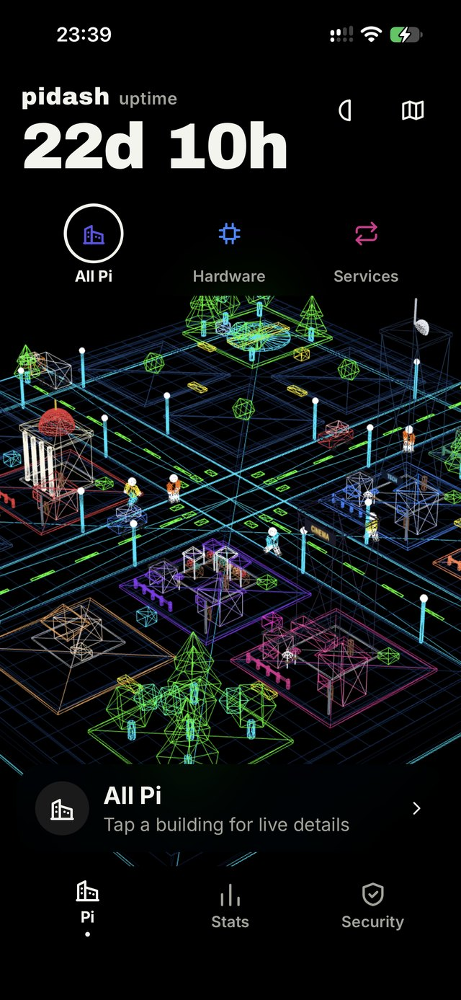
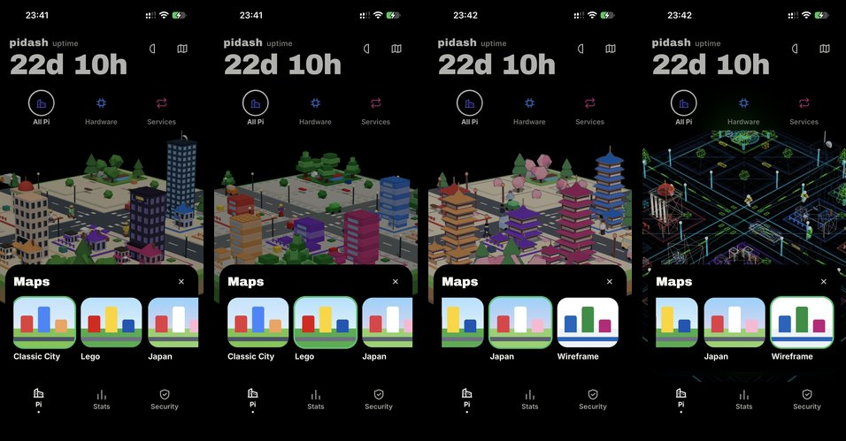
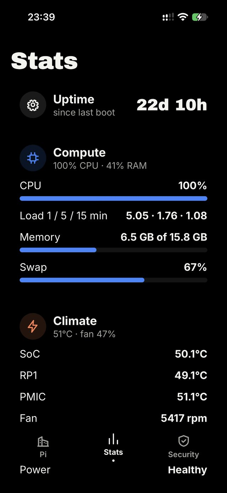
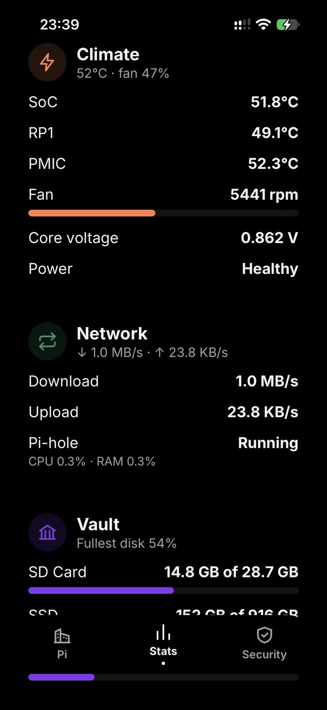
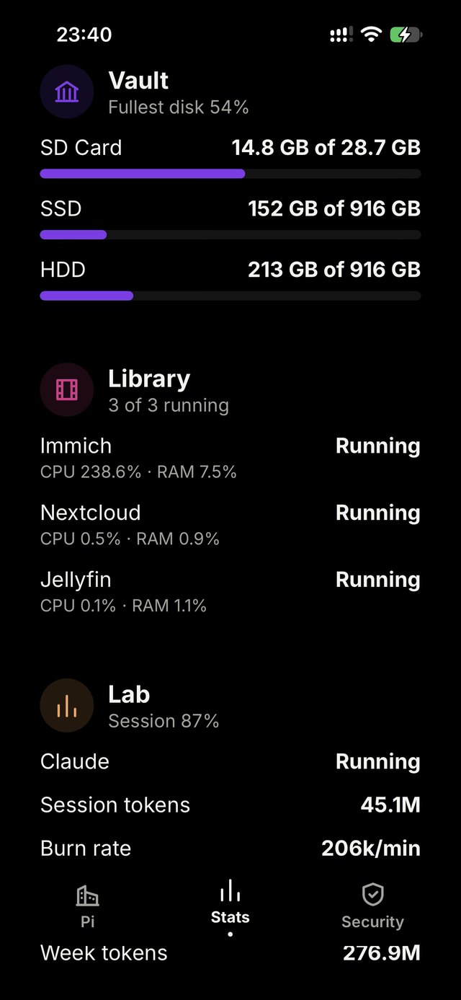
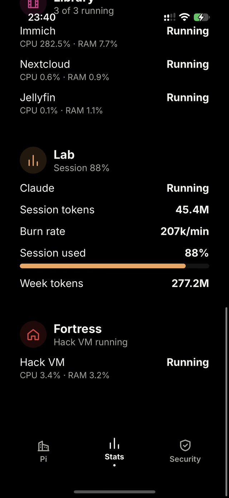
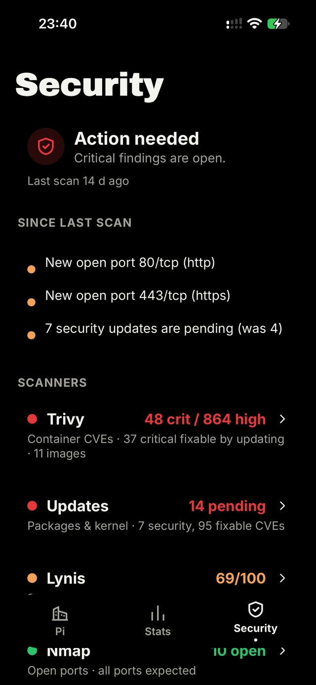

# pidash

*The metal I screwed, which maintains a healthy and sometimes long-distance relationship with my other PCs and network.*

<p align="center"></p>

### App Idea

I run a Raspberry Pi 5 as a small home server. It hosts my photos, my files, my media, my DNS filter, a lab VM and a few other things, and I wanted one place on my phone to see whether it's healthy. Not a wall of graphs: a quick look, and then a way to dig in when something is off.

Most dashboards I tried were either a Grafana panel I would never open, or a page of numbers that told me nothing at a glance. I already had a map idea in my head from another app I'm building, [`$?`](https://github.com/worstpoetGIT/dollar-q), where your spending grows a tiny 3D state. So I thought: what if the Pi was the state? Each part of the machine is a county, and its building grows as the load goes up.

I'm also a cybersecurity person, so the second half of the app is the security posture of the box: what the nightly scanners found, what changed since the last scan, and a way to run a test against my own services by hand. And, like `$?`, I built it because I'm broke: I didn't want to pay Apple $99 a year for a developer account just to put my own dashboard on my own phone, so it's sideloaded.

pidash reads from my own server and shows it. There's no third-party service, no analytics, no ads.

### The map

The home screen is a miniature city that **is** the Pi. It has 7 counties, and each building grows with how hard that part of the machine is working right now:

| County | What it is | What makes it grow |
|---|---|---|
| **Compute** | CPU and memory | the busier of CPU % and RAM % |
| **Climate** | temperatures, fan, core voltage | the hottest sensor |
| **Network** | the network port and the DNS filter | traffic (on a log scale) |
| **Vault** | the SD card, the SSD and the HDD | the fullest disk |
| **Library** | the photo, file and media apps | how many are up, and how busy |
| **Lab** | the AI coding assistant | how much of its usage limit is spent |
| **Fortress** | the hacking lab VM | up or down |

A county is a plot that goes from an empty lot with a sign (the service is down) up to a tall building (maxed out), in 14 levels. Tap a building and the camera flies to it and a card opens with the live numbers and bars. The chips at the top filter the map into **Hardware** and **Services**.

<!-- screenshot: a county selected, with the live-details card -->

The map is the same Three.js scene as `$?`, with four of its skins, picked from the map button at the top right: **Classic City**, **Lego**, **Japan** (an anime look with cel shading and ink outlines) and **Wireframe**. The button next to it cycles **System, Light and Dark**. Light is all white and Dark is all black, with no borders and no grey fills, because that's how `$?` looks and I wanted the two apps to feel like siblings.

<p align="center"></p>

### Stats

The Stats tab is every number behind the buildings, one card per county: CPU and load, memory and swap, each temperature, fan speed, core voltage and whether the Pi has ever undervolted, network rates, disk usage per disk, and the live CPU and RAM of every service.

<p align="center">&nbsp;&nbsp;&nbsp;</p>

### Security

The Security tab is the part I care about most. It shows:

- **A verdict**: *All clear*, *Worth a look* or *Action needed*, from the worst result of any scanner.
- **Since last scan**: what changed, like *New open port 443/tcp* or *7 security updates are pending (was 4)*.
- **Seven scanners**, each with a status dot, a headline and a drill-down:
  - **Trivy**, known CVEs in the container images
  - **Updates**, pending packages, security updates and kernel
  - **Lynis**, system hardening index and suggestions
  - **Nmap**, open ports, with unexpected ones called out
  - **Nuclei**, web vulnerability templates against each web app, with findings tagged by OWASP Top 10 category
  - **ClamAV**, malware scan of uploaded files
  - **fail2ban**, SSH bans
- **A scan log** of every past run, one dot per scanner.

<p align="center"></p>

The scanners themselves run on the Pi as root on a systemd timer and write JSON; the app only reads it.

**One-tap fixes.** At the top of the Security tab there is a short list of things I can fix from the phone: install the pending security updates, restart the scan timer, run all scans now. A fix is never a single blind tap. Tapping **Fix** opens a sheet with the exact commands it will run and, for updates, an `apt` dry run. Only **Apply** runs anything, and the output streams live. The update list is read from `apt` at that moment, not from the last scan, and packages that could cut my own connection or take everything down (Docker, k3s, Tailscale, the kernel, OpenSSH, libc) are held back for me to do by hand. Container CVEs and Lynis hardening items are not one-tap on purpose, because updating images can break the apps.

**A private console.** Two more things act on the Pi, so they stay on the private Tailscale address and are not in the phone app:

- a **manual pentester**: pick one of my own assets (the Pi, the lab VM, a web app) and a test (ports and services, SSH and TLS audit, or Nuclei web templates), run it, watch the live output and keep the result in history. It's an allowlist of my own targets, with no free-form host.
- a **CI/CD pipelines** panel that lists the latest GitHub Actions runs of this repo and can start one.

### What's not in the app, on purpose

- No fix that runs without showing its commands first.
- No accounts of its own. The phone app reads the Pi over Tailscale, so there's no login. The website, which I only use on a computer, sits behind a Cloudflare Access login.
- No tracking and no third-party requests from the app. Fonts are bundled.
- No way to reach the fixes, the pentester or the pipelines from the internet. They only answer on my Tailscale network.

### Install

pidash needs a **server to show**: the app has no data of its own, so there's nothing to see without the backend behind it (see [How it works](#how-it-works)). The address of that server is baked into the app when it's built, so the file on the [Releases](../../releases) page (v0.1.0, an early build that loads my own site) is only useful to me. To get your own:

1. Fork this repo.
2. In your fork go to **Settings, Secrets and variables, Actions, Secrets** and add `PIDASH_API_URL`, the address of your Pi's API, for example `http://100.x.y.z:5191`. Use a secret, not a variable, so the address stays out of the public build logs.
3. Run the **Build iOS app** workflow. It makes `pidash-unsigned.ipa` with your address inside.

That address has to answer the read-only `/api` paths listed under [How it works](#how-it-works). I use the Pi's Tailscale address with a small proxy in front of the API, so the phone needs Tailscale turned on to see anything.

The iPhone file is **not signed**, because Apple only lets you run signed apps and I'm not paying them for that. You sign it yourself with a sideloading tool and your own free Apple ID. I use [AltStore](https://altstore.io).

**How I keep it signed.** A free Apple ID signature lasts **7 days**, and I don't want to redo the install by hand every week. I run [AltServer](https://altstore.io) on a Raspberry Pi at home, signed in with my Apple ID. Whenever my iPhone is connected to my home network, the server re-signs the app in the background before the 7 days run out. If you don't have a machine that stays on at home, installing over the top again by hand every week is the way.

A free Apple ID also allows only **3 sideloaded apps at once**, so check your count before you install.

### Tech Stack

| Part | What I used |
|---|---|
| UI | React 19, plain JavaScript (no TypeScript, no router, no state library) |
| Build | Vite 8 |
| 3D map | Three.js 0.187, used directly (no React wrapper) |
| Styling | One CSS file with CSS variables for the themes, fonts bundled with Fontsource (Archivo Black, Inter) |
| Phone shell | Capacitor 8 for iPhone, with the UI bundled in and native HTTP calls to the Pi |
| Native plugin | Haptics |
| Private console service | FastAPI and uvicorn, bound to the loopback address |
| CI | GitHub Actions: a security workflow (gitleaks, `npm audit`, `pip-audit`, Trivy) on every push and weekly, and a macOS runner (`xcodebuild`) that builds the IPA |
| Target | iOS 15 and up, iPhone only |

The app is about 2,700 lines and the private console service about 250. There is no database: the app keeps one tiny preference object (the map and the appearance) in `localStorage`, and everything else is read live from the server.

### How it works

**Data.** The app polls the server's `/api/stats` every 5 seconds with a 6 second timeout, and marks the Pi offline after 2 failures in a row. Claude usage is polled every 30 seconds and the security report every minute. The endpoints it reads are:

```
/api/stats                 cpu, mem, disks, fan, power, network, temps, uptime, services[]
/api/claude-usage          session tokens, burn rate, usage
/api/security/report       one object per scanner, a summary and the alerts
/api/security/history      the list of past scan runs
```

The backend that serves them is a small FastAPI app on the Pi, separate from this repo. It also serves the built website. For the phone, a small proxy on the Pi's Tailscale address forwards only those read-only `GET` paths, so nothing that changes the Pi is reachable from the app.

**The map.** `src/CityScene.js` is a plain class, React only gives it a `<div>`. It owns the renderer, the camera, `OrbitControls`, a raycaster for tapping counties and the render loop, which stops when you leave the tab. Nothing is loaded from a file: every building, tree, car and person is built in code from boxes, cylinders and cones, and the only textures are drawn on a canvas.

**Counties and levels.** `buildCounties()` in `src/data.js` turns the live stats into 7 county objects: a name, a building style, a colour, the rows shown in the card and a level from 1 to 14. A level is `1 + load% × 13 / 100`. A county with nothing running (the service is down) is drawn as an empty plot. When a level goes up, the scene builds only the new pieces, one after another, with a crane on the lot.

**Map skins.** `src/maps.js` holds a recipe for each map: palette, buildings, vehicles, people, trees, lighting and fog. Changing the map throws away the world group and builds it again from the new recipe, which is why everything changes together.

**The private console.** `secops/` is a small FastAPI service on the loopback address, reachable only through a proxy on my Tailscale network. It's deliberately boring:

- Every action is a fixed id from a fixed table. Nothing typed in the UI is ever put into a command line. The only values that reach a command are package names, which come from `apt` itself, match a strict pattern and are checked against the hold list.
- Fixes are two steps: a plan, which shows the commands and a dry run, then an apply that needs the plan's id and expires after 5 minutes. They run through `sudo`, so this service can change the Pi. That's why it only listens on the loopback address, behind a proxy that only my Tailscale network can reach.
- Pentest targets come from a local config file that isn't in the repo (`secops/targets.example.json` shows the format), so there's no free-form host and no ranges.
- Every `POST` needs a custom header, an allowed `Host` and a same-origin `Origin`, which stops a web page from firing requests at it.
- One job at a time, hard timeouts, capped output, and an audit log of every run.

**The phone app.** Capacitor wraps the built UI inside the app, in a full-screen web view with no scrolling or link previews, locked to portrait. The data calls don't go through the web view's `fetch`: they use Capacitor's native HTTP, which has no cross-origin rules and real timeouts. The server address isn't in the repo: the workflow passes it to the build from the `PIDASH_API_URL` secret. Haptics use Capacitor's native plugin when it's there and fall back to the single tick iOS Safari allows. In the phone build the Pentest and Pipelines panels are hidden, because they belong to the private console. The app is also in a minimal mode: the iOS status bar is hidden.

### Project layout

```
src/
  main.jsx            entry point, crash guard
  App.jsx             tabs and screens
  data.js             polling, and the 7 counties built from the live stats
  store.js            the two saved preferences
  CityScene.js        the 3D map (Three.js)
  maps.js             the map skins
  haptics.js          native and web haptics
  components/         Home, Stats, Security, SecOps, Icon
secops/               the private console service
ios/                  Capacitor iOS project
build-ios.sh          unsigned IPA build for a Mac
scripts/              deploy the built website to the server
.github/workflows/    security checks and the IPA build
docs/screenshots/     the pictures in this README
```

### Testing

There is no automated test suite yet. I check things in a headless browser at phone size and on my own iPhone. The security workflow runs on every push and checks for committed secrets, vulnerable dependencies and known CVEs in the repo.

### License

MIT, see [LICENSE](LICENSE).
